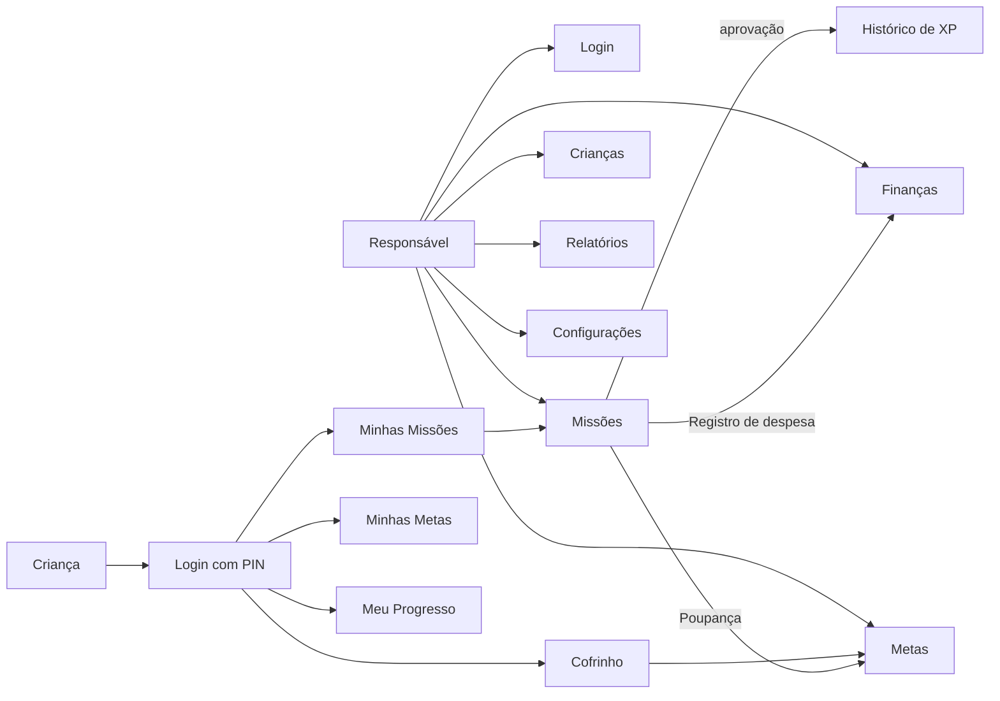

# Casos de uso

## Responsável
1. Entrar no sistema.
2. Cadastrar criança.
3. Registrar receita/despesa.
4. Criar meta.
5. Contribuir para meta.
6. Criar missão.
7. Aprovar ou recusar missão.
8. Consultar relatórios.
9. Gerenciar categorias/orçamentos.
10. Fazer backup/restauração.

## Criança
1. Entrar com PIN.
2. Visualizar missões.
3. Marcar missão como feita e enviar entrega.
4. Acompanhar aprovação.
5. Consultar metas.
6. Contribuir com o cofrinho.
7. Consultar XP e nível.
8. Guardar dinheiro no cofrinho.

## Diagrama Mermaid

